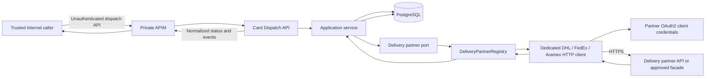
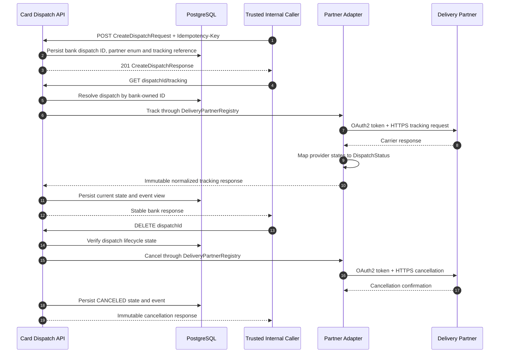

# Card Dispatch Tracking Service

The bank API has three operations: `POST /api/v1/card-dispatches` creates a
dispatch, `GET /api/v1/card-dispatches/{dispatchId}/tracking` tracks it, and
`DELETE /api/v1/card-dispatches/{dispatchId}` cancels it. All API request and
response models are immutable Java records; create requests select one of
`DHL`, `FEDEX`, or `ARAMEX`, and the service routes that enum through
`DeliveryPartnerRegistry`. The requested integration must be enabled in service
configuration. Carrier availability is checked for the partner requested by
each API call, so a missing configuration for an unused carrier does not stop
startup. Inbound authentication and dispatch ownership checks are disabled. The
service must be reachable only from trusted internal networks; any caller who
can reach it and knows a dispatch ID can track or cancel that dispatch.
Partner OAuth2 credentials and status translation remain internal for outbound
carrier calls.

## Design





## Extension contract

The API request contains a `DeliveryPartner` enum. `DeliveryPartnerRegistry`
routes that selected enum to one
dedicated `DhlDeliveryPartnerClient`, `FedExDeliveryPartnerClient`, or
`AramexDeliveryPartnerClient`. Each client uses the shared OAuth2/HTTP transport, maps
carrier status vocabulary to `DispatchStatus`, and returns an immutable
`TrackingSnapshot`; the API mapper exposes only immutable bank DTOs. New
partners require an internal enum value, client bean, partner configuration,
status mapping, and tests without changing mobile contracts. Credentials are
supplied through secret management, never source control.

The clients expose only normalized status, description, estimated date, and
event list. Configure these selected fields as customer-safe and redact any
carrier-specific customer details before returning a snapshot. The registry
fails closed if multiple clients claim the same enum.

Disabled DHL, FedEx, and Aramex profiles are declared in `application.yml`
with dedicated OAuth2 registrations and endpoints. Native carrier API details
vary by product and were not supplied. The clients currently consume the
documented normalized carrier-facade response contract and issue a configured
DELETE for cancellation; use an approved facade or complete and verify each
client's native request/response adapter before enabling it. Replace placeholder
identity issuers/endpoints, OAuth scopes, status mappings, and credentials from
carrier onboarding materials. No live certified integration is claimed.

## Statuses and errors

Carrier states map to the bank-owned `DispatchStatus`: `REGISTERED`,
`DISPATCHED`, `IN_TRANSIT`, `OUT_FOR_DELIVERY`, `DELIVERY_ATTEMPTED`,
`DELIVERED`, `RETURNED`, `CANCELED`, `EXCEPTION`, or `UNKNOWN`. Unknown
provider states become `UNKNOWN`; raw provider status and error payloads are
not returned to the app or written to logs. Transient partner and database
failures return stable error codes. Tracking GET performs a live partner lookup;
it does not silently serve a stale snapshot when the partner is unavailable.

PostgreSQL stores the dispatch routing reference, latest normalized state, and
latest partner event view. Carrier cancellation is confirmed before local
status changes; retries should use an idempotent carrier cancellation contract.
Protect the database with restricted service credentials, encryption at rest,
backups, retention controls, and network policy.

## Network security and operations

- The service performs no inbound authentication or ownership checks. Expose
  it only on a private network and permit traffic only from approved internal
  workloads. Do not expose it directly to the internet or untrusted clients:
  a dispatch ID is sufficient to view tracking data or request cancellation.
- Partner calls require HTTPS, OAuth2 client credentials, bounded connect and
  response timeouts, and secrets from the approved secret manager.
- Restrict partner egress to allow-listed endpoints and monitor partner/API
  availability, latency, HTTP outcomes, and OAuth token acquisition without
  logging tokens or tracking numbers.
- Configure PostgreSQL HA, migrations, least privilege, backups, retention,
  and operational alerting before production use.
- Health endpoints expose liveness/readiness only; logs include a validated
  correlation ID and exclude dispatch/tracking details.

## Promptfoo API checks

`promptfooconfig.yaml` exercises the unauthenticated tracking API using an
existing test dispatch. Run it from this directory after the API is available:

```sh
npx promptfoo@latest eval -c promptfooconfig.yaml
```

Provide `CARD_DISPATCH_API_BASE_URL` and `PROMPTFOO_DISPATCH_ID` through the
local shell or approved CI configuration. Use non-production dispatches.
